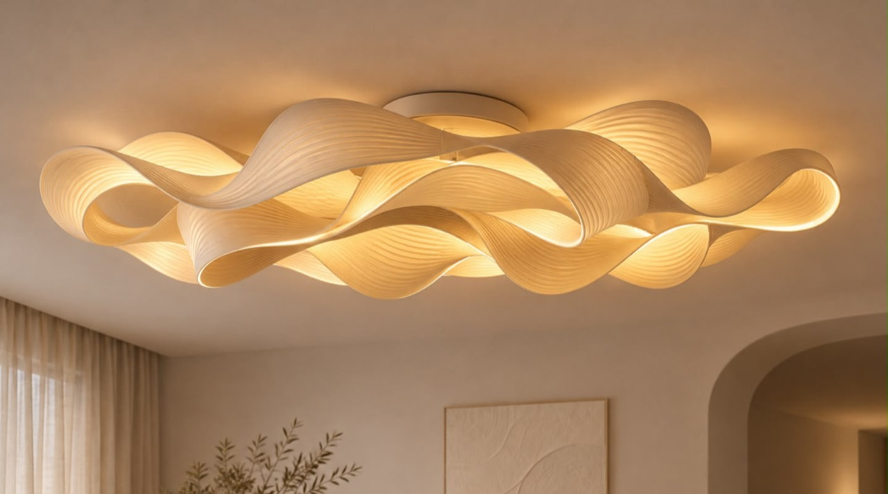

# Circular ribbon ceiling shade — project plan and model handoff

Updated: 6 November 2026

## Current design plan — harmony calculations V01

The radial layout was rejected because it made spokes. The approved lamp reads as three broad crossing loops: A and B run nearly parallel across the middle, C crosses diagonally, the wide right fold rolls under, and the lower sweep passes behind it. Preserve those relationships from the [reference map](harmony-plan/Reference-map.png), [approved underside](references/v11-approved-broad-ribbons-below.png), and [approved low angle](references/v11-approved-broad-ribbons-side.png).

The image outline scales to about 1,200 × 894 mm. To fit the user's round ceiling area without stretching the visible runs, the current planning envelope locally extends the outer lobes to 1,200 × 1,050 mm. Keep the target close to the ceiling with a 180 mm maximum drop. These are design constraints, not image measurements.

| Ribbon | Projected visible chord | Mean width / width at turn | Candidate bend | Estimated path budget |
|---|---:|---:|---:|---:|
| A · upper-left crest | 280 mm at −3.8° | 170 / 170 mm | R120 mm, 150°, 35 mm easing at each end | 1,900 mm |
| B · front-right fold | 292 mm at −9.1° | 150 / 180 mm | R125 mm, 165°, 35 mm easing at each end | 1,800 mm |
| C · lower sweep | 392 mm at +32.6° | 170 / 170 mm | R120 mm, 150°, 35 mm easing at each end | 2,000 mm |

Each candidate turn gives a 35 mm inner-edge radius. The full eased turns are about 349 mm for A/C and 395 mm for B. Keep the long visible runs straight, widen B only away from its tight core, and use one smooth height/bank transition through each fold. No periodic waviness or decorative surface ripple is part of this plan. The exact 3D paths and crossing heights remain to be resolved from both views.

The estimated 0.933 m² skin area gives about 1.90 kg PETG at 1.6 mm. Two integral 12 × 1.6 mm rear returns add about 0.28 kg. With seam/capture details, lights, and a compact central metal hub, the current assembled mass estimate is 2.70–3.17 kg without an onboard driver, or up to about 3.42 kg with one. Use 4.0 kg for the preliminary load screen. A 5× bench screen is 196 N; target 300 N per root seat, and aim for 400–450 mm positive support spans with 500 mm as the maximum in this first check. The U-section beam estimate is about 1.2 mm static deflection at 450 mm and 1.8 mm at 500 mm, but it excludes banked/twisted sections, creep, heat and joint flexibility.

The first print layout is 23–25 ribbon panels on the Kobra S1 Max. Use about 240–260 mm net advance and 20 mm integral laps, stagger seams and keep them away from bright runs and LED pockets. Put three short concealed LED pockets at selected bends, with each wire pair inside its own ribbon return to the central service cover. These dimensions stay provisional until the blockout and actual slicer boxes are checked.

The complete formulas, projected coordinates, beam assumptions, mass budget, attachment logic and remaining checks are in [harmony-plan/Full-calculation-v01.md](harmony-plan/Full-calculation-v01.md). The calculation is finished for review; **no Blender geometry has changed**. V13 remains the latest model checkpoint.

## Earlier single-return calculation

The user rejected the residual waviness and asked for the math before changing the Blender model. Take the dot as the centre of the shared mount. Lay out the dominant ribbon as one straight outward run, one deliberate turn and one straight return into a second seat on the same mount. Lay the surface lines at fixed offsets across the ribbon so they share the path and bend together. Stagger the locations and directions of the major turns across the lamp. [Dimensioned first-ribbon sketch](process/stills/22-first-ribbon-math.png)

The first trial keeps the visible width at 165 mm. In its bend plane the straight outward run starts at x = 45 mm and ends at x = 536 mm. The 190° bend has a 52 mm core radius and 24 mm linear curvature ramps at each end. The centreline length along the bend is 52 × (190π/180) + 24 = 196.4 mm. Integrating the tangent puts the tip at x = 600 mm and the bend exit at x = 527.1 mm, 102.0 mm below the outbound line in that plane. The 489.5 mm straight return brings the ribbon back to x = 45 mm at a rise of 10° in the bend plane.

The trial inclines the bend plane 72° from horizontal. Measured from the centre datum as outward, sideways and down, the seat centres are A = (45, 0, 32) mm and B = (45, 5.3, 48.2) mm. The greatest centreline excursion across the bend plane is 104.5 mm. The outside depth is approximately 32 + 104.5 sin(72°) + 82.5 cos(72°) = 157 mm before skin thickness. Root tab capture and overlap between ribbons remain to be worked out. This calculation defines the first ribbon only.

## Previous appearance trial — V13

V13 develops the right return of ribbon B as a near-straight approach, a broad turn and an eased exit. The approach measures 239.6 mm and widens from 130 to 165 mm. The turn carries 165 mm of width, with a 110 mm core radius in plan and 36 mm transitions at each end. The centre path turns 120° over 266 mm including the transitions. The face rolls independently by 62°. Compare the [side](development-v13/03-Low-side.png) and [underside](development-v13/02-Underside.png) with V12 before setting dimensions for the other folds. [Blender model](development-v13/Ribbon-Lamp-V13-Controlled-Fold.blend) · [Measured geometry](development-v13/Geometry-review.json)

## Previous appearance revision — V12

The user rejected the V11 rolled shape and asked to rebuild the curving lamp by itself, with one central hook and no roof. [V12](development-v12/README.md) redraws the two edges of each ribbon independently in 3D. The full-width left crest, right roll and rising lower sweep now determine the surfaces. The older V11 path arrangement is superseded for appearance.

The new skin envelope is approximately 1,191 × 889 × 227 mm. This is deeper than the earlier 160 mm working target. Review the isolated [angled underside](development-v12/01-Lamp-alone.png), [below](development-v12/02-Underside.png) and [low side](development-v12/03-Low-side.png) before fixing installation clearance. The shape has not received user acceptance yet.

The model contains one central mounting-eye envelope. The ribbons still need integral roots and captured joints to connect physically to it. Three selected bend lights are optical proxies; the old LED housing, wiring and joint studies have not been transferred to these new curves. Complete the visual review, then develop the central load path, local nesting joints and LED/wire channels, then the staggered print divisions. Do not release previous print panels as compatible with V12.

## V11 support, lighting and split plan

Use the [approved low-angle concept](references/v11-approved-broad-ribbons-side.png) and [approved underside concept](references/v11-approved-broad-ribbons-below.png) as the appearance references. Preserve the three broad and medium-width ribbons, their tucked overlaps, the shallow ceiling profile, and the irregular outline that fills a roughly round ceiling area. Keep about **1.2 m maximum span** and **160 mm drop** as working targets. The views guide the visible shape. The paths behind their overlaps will be resolved in the structural layout.

### Give each ribbon a route to the centre plate

Develop **two separated, mechanically captured seats for each ribbon** on the same compact metal ceiling plate. Put the seats and their keepers behind the centre cover. Use rear-facing integral folded returns to stiffen the longer spans. The load path is outer bend → ribbon and its return → captured seats → metal plate → ceiling fixings. Use the two tucked overlaps below to share load and resist twist between ribbons. Preserve access to the centre fasteners and the service cover.

| Ribbon | Proposed attachment and overlap | Candidate light pocket |
| --- | --- | --- |
| A · Broad upper sweep | Two centre seats. Nest its wide right return against B at the primary overlap. | Upper-right inner fold, offset from the nesting joint |
| B · Medium middle return | Two centre seats. Add the matching concealed bearing face and captive lip at the right overlap. | Left turned-back end |
| C · Broad lower sweep | Two centre seats. Bring a rear return into the left overlap and check that its long face clears the two bands above. | Inside the lower bend |

At the right overlap, one folded edge should seat on a broad mating face. A captive lip and concealed end stop should prevent lift and slide-out. Put the stop on an accessible side during bench assembly. Verify insertion and release direction before splitting the ribbons for printing. Check the left overlap as a second bearing and anti-twist point if there is enough hidden contact area. If the centre cannot fit the captured seats and the service connection, reroute the hidden inner returns before changing the visible outline.

The V10 geometry is a construction reference. Its paired A/C seats and two left-side bonded contacts do not establish the load path of this new arrangement. Verify stiffness, pull-out, retention and sustained sag at the actual span and operating temperature. Confirm the ceiling mount and secondary retention for the assembled weight before overhead use. [V10 seat coordinates](full-lamp-v10/Build-map.json) · [NIST on qualification of additively manufactured parts](https://www.nist.gov/programs-projects/additive-manufacturing-part-qualification)

### Hide the emitters and wiring

Start with one short warm COB strip in the right-hand pocket and add the other candidate stations only where the render and sample need more fill. Recess each strip on a short aluminum heat spreader behind the inner return. Aim it across the hollow toward the facing curve. Check below and at the lowest normal room angle with the actual strip and filament. The fold should hide the emitter, connector and heat spreader and the transmitted light should avoid distinct hardware shadows.

Route each 24 V wire pair along the hidden rear edge of **its own ribbon** back to a labelled parallel connection under the centre cover. Keep wires off bearing faces, out of keyed slots, and away from the heat spreader. Cross print joints through a recessed, protected exit with assembly slack. Check routing and connector access during the dry fit before bonding. Keep access to the splitter and driver. Size pockets and wiring once the tape width, marked cut pitch and actual strip requirements are known. [LEDVANCE strip installation guidance](https://www.ledvance.com/00_Free_To_Use/asset-13084976_led_strip_value_ip00.pdf)

### Divide the panels after the pockets and support zones are fixed

Keep the brightest curves, pocket openings, and structural overlaps within individual panels wherever possible. Try the upper crossing, the far-side return and the shaded inner sweep as different seam zones. Pick the actual cuts independently and stagger them between bands. Use integral rear laps with matched ripple alignment. Keep the wiring recess beside the overlap so the joint can close freely. Preserve the low-angle silhouette and check the back for tool and hand access before releasing any cut map.

The **Kobra S1 Max** has a **350 × 350 × 350 mm** build volume. Use about **320 mm per axis** as the working envelope in the chosen orientation, including brim and supports. Test diagonal placement for the widest sweeps and set part count after checking orientations and thin-wall toolpaths. Compare curved samples at **0.16 and 0.20 mm** in the actual milky PETG. Let the intentional long ripples carry the visible pattern and place the slicer perimeter starts on a tucked edge. [Anycubic Kobra S1 Max specifications](https://store.anycubic.com/collections/fdm-printer/products/kobra-s1-max) · [OrcaSlicer seam painting](https://github.com/orcaslicer/orcaslicer/wiki/prepare_seam_painting)

### Blender development checkpoint

The [rolled V11 revision](development-v11-rolled/README.md) is the current Blender checkpoint. It deepens the left, right and lower curves across their width and raises the centre cover into the overlaps. The bench joint remains a separate fit study while the real overlap and centre seats are engineered.

The [V11 Blender development file](development-v11/Ribbon-Lamp-V11-Development.blend) contains the initial full-size ribbon layout and a separate right-hand captive-joint study. One candidate LED envelope has been placed between the right-hand folds. The [development notes](development-v11/README.md) record the sampled overlap and checks. The six centre seats, the blend of the trial joint into the ribbon, the continuous wire runs, and the final panel divisions remain open.

### Next work in order

1. Map the three uninterrupted ribbon paths in plan and draw sections at the centre, right nesting joint and left overlap. Check the low profile and assembly direction.
2. Make a full-size test of the right joint plus an adjacent light pocket and wire exit. Evaluate fit, retention, access, glow and thermal behaviour on the bench.
3. Lay out and slice the staggered panels around the confirmed zones. Print a matching seam pair for alignment and illuminated finish.
4. Complete the Blender assembly and numbered exports once the structural, optical and print layouts are settled.

## V10 simplified load path

The [V10 full lamp](full-lamp-v10/README.md) removes V09's separate carrier arms, splice pieces and lower-right curl. Only the centre canopy attaches to the ceiling. A and C share two concealed centre fasteners, B has two seats within the same canopy, and two contact lands are integral to adjacent ribbon overlaps. The 19 skin panels join at 12 mm built-in half-laps. The low-profile geometry drops about 160 mm from the ceiling. Three compact COB runs inside the canopy replace the remote channels. A test pair and physical validation of the centre-supported assembly are required before overhead use.

## V09 full-lamp handoff

The [complete V09 model and print set](full-lamp-v09/README.md) supersede the 33-piece draft map. The supplied underside image takes precedence for the outline. The resulting shade is about 1.2 m wide and 0.93 m deep in plan. The full assembly retains a centre-only ceiling attachment and contains 22 numbered ripple panels, 42 rear splices, 10 mounting pads and a removable centre cover. Three short upward-facing LED runs share one 24 V connection, with wires routed inside their metal branches. The exact appearance and overhead retention remain bench validation tasks.

## V08 bench checkpoint

The new [underside view](prototype-v08/underside-reference.png) is a second visual reference. The [V08 Blender bench project](prototype-v08/Ribbon-V08-fold-prototype.blend) uses a full-size piece of V07 W01 to test a rear splice and upward-facing light channel. The [test notes](prototype-v08/README.md) link the four trial STLs and results. The model includes a provisional 33-piece cut overlay in the V07 context scene. Most draft seams are exposed from below and need to move into overlapping folds. The lit bench render shows shadows from the splices and channel. Use this result to place hardware out of the light path through the show surfaces before releasing full-shade parts.

## Current study — V07, central ceiling attachment only

Latest project: **[Circular-Ribbon-Cloud-v07-centre-mount.blend](Circular-Ribbon-Cloud-v07-centre-mount.blend)**. Preserve V01–V06b and their recordings as history. The user rejected the broad ceiling base: **only the middle part may attach to the ceiling.** Do not reintroduce a large backing plate, ceiling-wide light deck or outer ceiling fixings.

The V06/V06b 900 mm light deck was an incorrect design direction and is removed from V07 geometry. The only ceiling-contact assembly is the central **Ø220 × 48 mm canopy**, with a metal plate and four provisional fixing clearances within that central footprint. Three internal branches carry the shade from the central hub, through the upper folds. They do not attach to the ceiling anywhere else. See [current carrier/lighting study](lighting-v07/README.md) and [geometric ceiling-contact check](checks/v07-centre-contact-check.json).

The rippled ribbon skins are retained from the pre-deck composition checkpoint, approximately 1,200 mm circular footprint and 280 mm total drop. The old long tongues reaching up to the large deck are removed. Paired back-side saddle/stud placements now connect each ribbon to the centre-rooted carrier. These small joint studies still require seating, retention, union into print parts and load/creep validation; visible housings/connections remain an unresolved appearance issue.

The user clarified that the missing detail is **ripples across ribbon surfaces**, not a request to add more folded pieces. Keep V06b's shallow parallel pleats: main counts 28 / 25 / 20, shorter bands 13 / 12 / 12, approximately 6 mm starting broad-band pitch and 0.5 mm source amplitude. These are deliberate shape features, not simulated fine FDM layers. Preserve the soft white washi character and unpainted light transmission.

Lighting is relocated to **six selected stations with twelve straight 100 mm modules**, directed into nearby ribbon backs. No perimeter light deck. Nominal prototype strip total: 1.2 m / 9.6 W / 0.40 A at 24 V. Metal heat beds, small baffled optical cells and low-voltage routes are modeled. Their current visibility, diffusion and thermal performance are unproven. Driver/controller envelopes at the centre are space reservations, not selected V07 hardware. Do not use the superseded V06 strip length/power/driver selection.

Review [warm](renders/v07-centre-warm.png), [unlit](renders/v07-centre-unlit.png), [directly below](renders/v07-centre-below.png), and the [carrier-only technical cutaway](renders/v07-centre-carrier-cutaway.png). All physical support geometry remains enabled in normal views. **The centre-only mounting correction is implemented; overall aesthetic and manufacturing acceptance remain open.**

Digital skin checks: six connected closed evaluated skins with zero detected non-manifold edges and zero pairwise skin intersections. Bare-skin volume estimates about 1.79 kg at nominal PETG density 1.27 g/cm³; all saddles/hardware/lighting are excluded. This is not a weighed assembly or a capacity result. No V07 printable package is released; earlier fit STLs do not apply.

Process media: [initial live centre-mount revision review](process/videos/12-v07-centre-mount-revision.mp4) and [latest live V07 review](process/videos/13-v07-current-review.mp4). These are real Blender-window recordings, not manual construction footage or rendered animations. Modeling was performed through Blender Python; the source is embedded. Follow [PROCESS.md](PROCESS.md).

## Reference image

The image establishes the flowing ribbon language, layered overlaps, fine surface ribs, warm glow, and concealed mounting. A single photograph does not establish exact topology, dimensions, construction, or lighting placement. Reconstruct those through the development stages below.

## Confirmed user decisions

| Item | Agreed direction |
| --- | --- |
| Footprint | Circular, approximately **1,200 mm diameter** |
| Appearance | Closely follow the reference's flowing, overlapping ribbon design |
| Installation | Close to the ceiling; **central canopy is the only ceiling attachment** |
| Lighting role | Decorative warm ambient feature |
| Optical effect | Light passes through the ribbon material |
| Visible finish | Unpainted soft-white washi character with designed shallow parallel surface ripples; real FDM texture still requires samples |
| Product goal | A printed shade for future sale |
| Prototype lighting | User will purchase an LED strip; develop around a separately sourced lighting system |
| Priority | Neat, premium appearance and strong visual impact |
| Budget | No firm prototype budget cap; appearance takes priority |
| Printer | Anycubic Kobra S1 Max |

The final circular choice supersedes an earlier oval proposal. The final light-through-material choice supersedes an earlier sanding-and-painting preference. Preserve those latest choices when continuing.

## Starting design and construction approach

- Use an initial overall ceiling-to-lowest-edge target of approximately **280 mm for the current V07 study**, including the canopy. This is a design starting point, pending room clearance and the concept views.
- Arrange broad, independently editable twisted ribbons around a central mount. Maintain an overall circular footprint with organic waves and local asymmetry.
- Build editable curves or surface sweeps with adjustable width, twist, and wave height. Keep a clean master surface before applying thickness and print segmentation.
- Keep visible ribbons, concealed support, lighting carriers, and canopy as separate components and Blender collections.
- Use a concealed metal support structure with mechanical retention for the printed modules. Make the shade removable without disturbing electrical connections.
- Place whole module boundaries behind folds or separate overlapping ribbons. Avoid exposed lap joints in luminous surfaces: doubled thickness can create dark bands.
- Determine module count and split positions from the full-scale blockout and actual slicer orientations. Do not promise an arbitrary small number of pieces before checking fit and surface quality.
- Choose print orientations before freezing the twists. Redesign or split sections where supports would damage the main presentation surfaces.
- Keep fine print lines out of the mesh. Use printed texture/orientation samples to develop a deliberate washi-like finish.

## Printer, material, and lighting starting points

### Printer

- Kobra S1 Max nominal build volume: **350 × 350 × 350 mm**.
- Standard nozzle: **0.4 mm**; use this for the initial finish tests.
- Target approximately **320 mm maximum occupied extents per axis**, including any brim or supports, to leave margin inside the build volume.
- Start finish testing around **0.16 mm layer height** and tune using the actual material and geometry. Treat this as a trial setting, not a validated production profile.
- Check each oriented module and its print allowances in the slicer. Use the exact Kobra S1 Max printer profile.

Source: [Anycubic Kobra S1 Max specifications](https://store.anycubic.com/products/kobra-s1-max).

### Material and finish

- Start with **milky, light-diffusing PETG** as the shade material candidate. Select the actual filament from illuminated samples; colour names do not establish transmission or diffusion.
- Compare approximately **0.8, 1.2, and 1.6 mm base walls**, with print-orientation and layer-height variations over a consistent smooth skin.
- Assess unlit colour, lit colour, diffusion, stiffness, print consistency, and the visibility of internal hardware.
- Keep luminous surfaces unpainted. Use controlled printing and light cleanup that preserves consistent translucency and the intended intrinsic print texture.
- A painted canopy or concealed structural cover is compatible with this approach.
- PETG has greater heat resistance than PLA, but that does not validate this lamp's operating conditions. Evaluate the actual filament, LED arrangement, attachments, and temperatures together.

Source: [Prusament PETG material information](https://prusament.com/materials/prusament-petg/).

### Lighting and compatibility

- Starting specification: **24 V constant-voltage, 2700 K, CRI 90+ dimmable COB LED strip**, with a compatible power supply and dimmer.
- Current candidate: selected short optical cells behind the folds, supported only from the central carrier. A broad ceiling light deck and perimeter ceiling fixings are rejected. Establish source/housing concealment and useful illumination with real samples.
- Respect the selected strip's permitted bend direction, minimum radius, cut pitch, mounting requirements, and temperature limits. Use wired connections between sections where needed.
- Aim for controlled warm gradients with brighter folds and softer shaded areas. Uniform brightness over every surface is not an established requirement.
- Select the exact strip, profile, dimmer, and power supply after optical trials. Freeze their relevant dimensions and operating limits before finalizing carrier geometry.
- Calculate total strip length and power from the proven layout, then size the supply using the manufacturer's loading and derating requirements.
- Provide access to replace lighting components. Specify the tested compatible lighting system for the future shade product; buyer-supplied strips cannot be assumed interchangeable.

Reference for strip specifications, profiles, and handling: [LEDVANCE LED strip system guide](https://www.ledvance.com/00_Free_To_Use/asset-13195065_led_strip_brochure_2024.pdf).

## Development stages and gates

| Stage | Work | Deliverable / condition to advance |
| --- | --- | --- |
| **1. Blender concept** | Build the circular full-scale silhouette, ribbon arrangement, canopy, support space, and indicative light carriers. | Editable concept assembly plus unlit and illuminated views from below, the side, and a room context. Review proportions before adding detailed connectors. |
| **2. Optical and finish samples** | Print material, wall-thickness, and print-texture samples. Illuminate them with the actual strip at several distances. | Select the filament, skin thickness, print-texture treatment, and useful LED spacing. Record settings and photographs. |
| **3. Full-size partial assembly** | Print one representative twist and its overlap with the next module. Include actual attachments and LEDs mounted on metal. | Demonstrate the surface, hidden joint, source concealment, stiffness, and removability at full size. A flat sample alone cannot pass this stage. |
| **4. Complete engineering** | Finalize print segmentation, alignment features, concealed fasteners, wiring clearance, and service access. | Numbered assembly, exploded view, checked printable meshes, and trial slicing of every unique part. |
| **5. Full prototype** | Print and assemble the complete shade, then evaluate it at representative ceiling height. | Confirm appearance, balance, sag, clearances, attachment, thermal behaviour, and lighting replacement access. |
| **6. Repeatable product package** | Freeze the successful geometry, material, hardware, lighting compatibility, and production process. | Editable master, manufacturing exports, printer projects, assembly instructions, bill of materials, measured costs, and validation record. |

## Validation and acceptance

- Inspect illuminated and unlit samples directly below and obliquely, at full and dimmed brightness.
- Main viewing surfaces should have no distracting LED dots or lines, exposed hardware, bright leaks, conspicuous joint bands, or unintended carrier shadows. Evaluate those in person as well as photographs.
- Check printed fit, assembly order, removal, and reassembly with the actual hardware. Establish clearances from fit samples rather than assuming a universal tolerance.
- Check export scale, closed/manifold meshes, wall continuity, self-intersections, assembly interference, and build-volume fit.
- Slice every unique module and inspect the actual toolpaths, thin walls, seams, supports, and visible surfaces before production printing.
- Run the intended LED assembly to thermal stability and through sustained full-output operation. Record ambient, shade, carrier, and relevant component temperatures; inspect deformation, sag, and attachment movement against the selected materials' and components' limits.
- Check the complete assembly for balance, ceiling clearance, service access, and sustained sag. Physical retention and installation must be validated with the actual assembled mass and hardware before overhead use.
- Record measured results separately from simulated results and assumptions. Renders and digital clearance checks do not establish physical performance.

## Files and workspace handling

- Document every meaningful development step with a short video when available, useful milestone stills, and an entry in **`PROCESS.md`**. Follow **`AGENTS.md`** for the recording and checkpoint requirements; this is an explicit user preference for the entire project.
- Keep this new project inside **`Circular-Ribbon-Lamp/`**.
- This **`PLAN.md`** and **`references/design-reference.jpg`** form the portable starting handoff. Keep their relative link intact when sharing.
- As work progresses, organize the editable Blender master, renders, print exports, slicer projects, and verification records in this folder.
- Existing files elsewhere in the workspace belong to a previous table-lamp project. Preserve them and do not reuse their dimensions or Snapmaker U1 print profiles for this shade.
- Save the concept first. Preserve an editable master when creating printable copies or applying modifiers.

## Outstanding information

- Actual room dimensions, ceiling height, and installation substrate.
- Exact filament and lighting components, to be selected through the sample stage.
- Sales country and target retail price.
- Final mounting hardware, installed mass, production time, and shipping configuration, to be established during development.
- Market-specific product validation and documentation before sale, once the intended market and product configuration are defined.

## Next action for another model

Preserve **central-only ceiling attachment**. There must be no broad base, no perimeter ceiling rail and no outer anchors. The compact centre carries the internal support and lighting. V06's deck is rejected history, not an available default solution. Inspect V07 and the reference before further geometry changes.

The surface-ripple clarification is implemented. The remaining visual work is to conceal light housings and internal connections within existing folds, simplify the crowded centre and improve transmitted glow. Do not add extra folded pieces as a substitute for surface pleats. Do not hide actual physical supports to produce an apparently successful normal render.

Resolve practical fabrication and center-anchor loads for the three illustrative hollow branches, final saddle seating/retention and reinforced printed parts, driver/controller choice for the revised 9.6 W layout, service access, print divisions and optical/thermal/sag tests. Use one full-size partial assembly before freezing the complete package.

V07 is generated by `scripts/build_v07_centre_mount.py`, starting from `checkpoints/v06b-composition.blend`. It replaces carrier/lighting only; old deck-attached tongues are absent. The section guides are references, not live deformers. Preserve a checkpoint before regeneration. Use `scripts/record_blender_window.swift` with the exact intended project title for future window-only clips, and keep the process journal current.
