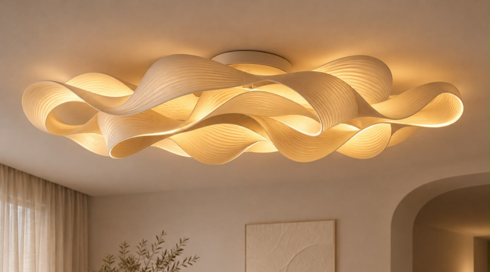

# Circular ribbon ceiling shade — project plan and model handoff

Updated: 4 November 2026

## Current study — V07, central ceiling attachment only

Latest project: **[Circular-Ribbon-Cloud-v07-centre-mount.blend](Circular-Ribbon-Cloud-v07-centre-mount.blend)**. Preserve V01–V06b and their recordings as history. The user rejected the broad ceiling base: **only the middle part may attach to the ceiling.** Do not reintroduce a large backing plate, ceiling-wide light deck or outer ceiling fixings.

The V06/V06b 900 mm light deck was an incorrect design direction and is removed from V07 geometry. The only ceiling-contact assembly is the central **Ø220 × 48 mm canopy**, with a metal plate and four provisional fixing clearances within that central footprint. Three internal branches carry the shade from the central hub, through the upper folds. They do not attach to the ceiling anywhere else. See [current carrier/lighting study](lighting-v07/README.md) and [geometric ceiling-contact check](checks/v07-centre-contact-check.json).

The rippled ribbon skins are retained from the pre-deck composition checkpoint, approximately 1,200 mm circular footprint and 280 mm total drop. The old long tongues reaching up to the large deck are removed. Paired back-side saddle/stud placements now connect each ribbon to the centre-rooted carrier. These small joint studies still require seating, retention, union into print parts and load/creep validation; visible housings/connections remain an unresolved appearance issue.

The user clarified that the missing detail is **ripples across ribbon surfaces**, not a request to add more folded pieces. Keep V06b's shallow parallel pleats: main counts 28 / 25 / 20, shorter bands 13 / 12 / 12, approximately 6 mm starting broad-band pitch and 0.5 mm source amplitude. These are deliberate shape features, not simulated fine FDM layers. Preserve the soft white washi character and unpainted light transmission.

Lighting is relocated to **six selected stations with twelve straight 100 mm modules**, directed into nearby ribbon backs. No perimeter light deck. Nominal prototype strip total: 1.2 m / 9.6 W / 0.40 A at 24 V. Metal heat beds, small baffled optical cells and low-voltage routes are modeled. Their current visibility, diffusion and thermal performance are unproven. Driver/controller envelopes at the centre are space reservations, not selected V07 hardware. Do not use the superseded V06 strip length/power/driver selection.

Review [warm](renders/v07-centre-warm.png), [unlit](renders/v07-centre-unlit.png), [directly below](renders/v07-centre-below.png), and the [carrier-only technical cutaway](renders/v07-centre-carrier-cutaway.png). All physical support geometry remains enabled in normal views. **The centre-only mounting correction is implemented; overall aesthetic and manufacturing acceptance remain open.**

Digital skin checks: six connected closed evaluated skins with zero detected non-manifold edges and zero pairwise skin intersections. Bare-skin volume estimates about 1.79 kg at nominal PETG density 1.27 g/cm³; all saddles/hardware/lighting are excluded. This is not a weighed assembly or a capacity result. No V07 printable package is released; earlier fit STLs do not apply.

Process media: [initial live centre-mount revision review](process/videos/12-v07-centre-mount-revision.mp4) and [latest live V07 review](process/videos/13-v07-current-review.mp4). These are real Blender-window recordings, not manual construction footage or rendered animations. Modeling was performed through Blender Python; the source is embedded. Follow [PROCESS.md](PROCESS.md).

## Reference image

The image establishes the flowing ribbon language, layered overlaps, fine surface ribs, warm glow, and concealed mounting. A single photograph does not establish exact topology, dimensions, construction, or lighting placement. Reconstruct those through the development stages below.

## Confirmed user decisions

| Item | Agreed direction |
| --- | --- |
| Footprint | Circular, approximately **1,200 mm diameter** |
| Appearance | Closely follow the reference's flowing, overlapping ribbon design |
| Installation | Close to the ceiling; **central canopy is the only ceiling attachment** |
| Lighting role | Decorative warm ambient feature |
| Optical effect | Light passes through the ribbon material |
| Visible finish | Unpainted soft-white washi character with designed shallow parallel surface ripples; real FDM texture still requires samples |
| Product goal | A printed shade for future sale |
| Prototype lighting | User will purchase an LED strip; develop around a separately sourced lighting system |
| Priority | Neat, premium appearance and strong visual impact |
| Budget | No firm prototype budget cap; appearance takes priority |
| Printer | Anycubic Kobra S1 Max |

The final circular choice supersedes an earlier oval proposal. The final light-through-material choice supersedes an earlier sanding-and-painting preference. Preserve those latest choices when continuing.

## Starting design and construction approach

- Use an initial overall ceiling-to-lowest-edge target of approximately **280 mm for the current V07 study**, including the canopy. This is a design starting point, pending room clearance and the concept views.
- Arrange broad, independently editable twisted ribbons around a central mount. Maintain an overall circular footprint with organic waves and local asymmetry.
- Build editable curves or surface sweeps with adjustable width, twist, and wave height. Keep a clean master surface before applying thickness and print segmentation.
- Keep visible ribbons, concealed support, lighting carriers, and canopy as separate components and Blender collections.
- Use a concealed metal support structure with mechanical retention for the printed modules. Make the shade removable without disturbing electrical connections.
- Place whole module boundaries behind folds or separate overlapping ribbons. Avoid exposed lap joints in luminous surfaces: doubled thickness can create dark bands.
- Determine module count and split positions from the full-scale blockout and actual slicer orientations. Do not promise an arbitrary small number of pieces before checking fit and surface quality.
- Choose print orientations before freezing the twists. Redesign or split sections where supports would damage the main presentation surfaces.
- Keep fine print lines out of the mesh. Use printed texture/orientation samples to develop a deliberate washi-like finish.

## Printer, material, and lighting starting points

### Printer

- Kobra S1 Max nominal build volume: **350 × 350 × 350 mm**.
- Standard nozzle: **0.4 mm**; use this for the initial finish tests.
- Target approximately **320 mm maximum occupied extents per axis**, including any brim or supports, to leave margin inside the build volume.
- Start finish testing around **0.16 mm layer height** and tune using the actual material and geometry. Treat this as a trial setting, not a validated production profile.
- Check each oriented module and its print allowances in the slicer. Use the exact Kobra S1 Max printer profile.

Source: [Anycubic Kobra S1 Max specifications](https://store.anycubic.com/products/kobra-s1-max).

### Material and finish

- Start with **milky, light-diffusing PETG** as the shade material candidate. Select the actual filament from illuminated samples; colour names do not establish transmission or diffusion.
- Compare approximately **0.8, 1.2, and 1.6 mm base walls**, with print-orientation and layer-height variations over a consistent smooth skin.
- Assess unlit colour, lit colour, diffusion, stiffness, print consistency, and the visibility of internal hardware.
- Keep luminous surfaces unpainted. Use controlled printing and light cleanup that preserves consistent translucency and the intended intrinsic print texture.
- A painted canopy or concealed structural cover is compatible with this approach.
- PETG has greater heat resistance than PLA, but that does not validate this lamp's operating conditions. Evaluate the actual filament, LED arrangement, attachments, and temperatures together.

Source: [Prusament PETG material information](https://prusament.com/materials/prusament-petg/).

### Lighting and compatibility

- Starting specification: **24 V constant-voltage, 2700 K, CRI 90+ dimmable COB LED strip**, with a compatible power supply and dimmer.
- Current candidate: selected short optical cells behind the folds, supported only from the central carrier. A broad ceiling light deck and perimeter ceiling fixings are rejected. Establish source/housing concealment and useful illumination with real samples.
- Respect the selected strip's permitted bend direction, minimum radius, cut pitch, mounting requirements, and temperature limits. Use wired connections between sections where needed.
- Aim for controlled warm gradients with brighter folds and softer shaded areas. Uniform brightness over every surface is not an established requirement.
- Select the exact strip, profile, dimmer, and power supply after optical trials. Freeze their relevant dimensions and operating limits before finalizing carrier geometry.
- Calculate total strip length and power from the proven layout, then size the supply using the manufacturer's loading and derating requirements.
- Provide access to replace lighting components. Specify the tested compatible lighting system for the future shade product; buyer-supplied strips cannot be assumed interchangeable.

Reference for strip specifications, profiles, and handling: [LEDVANCE LED strip system guide](https://www.ledvance.com/00_Free_To_Use/asset-13195065_led_strip_brochure_2024.pdf).

## Development stages and gates

| Stage | Work | Deliverable / condition to advance |
| --- | --- | --- |
| **1. Blender concept** | Build the circular full-scale silhouette, ribbon arrangement, canopy, support space, and indicative light carriers. | Editable concept assembly plus unlit and illuminated views from below, the side, and a room context. Review proportions before adding detailed connectors. |
| **2. Optical and finish samples** | Print material, wall-thickness, and print-texture samples. Illuminate them with the actual strip at several distances. | Select the filament, skin thickness, print-texture treatment, and useful LED spacing. Record settings and photographs. |
| **3. Full-size partial assembly** | Print one representative twist and its overlap with the next module. Include actual attachments and LEDs mounted on metal. | Demonstrate the surface, hidden joint, source concealment, stiffness, and removability at full size. A flat sample alone cannot pass this stage. |
| **4. Complete engineering** | Finalize print segmentation, alignment features, concealed fasteners, wiring clearance, and service access. | Numbered assembly, exploded view, checked printable meshes, and trial slicing of every unique part. |
| **5. Full prototype** | Print and assemble the complete shade, then evaluate it at representative ceiling height. | Confirm appearance, balance, sag, clearances, attachment, thermal behaviour, and lighting replacement access. |
| **6. Repeatable product package** | Freeze the successful geometry, material, hardware, lighting compatibility, and production process. | Editable master, manufacturing exports, printer projects, assembly instructions, bill of materials, measured costs, and validation record. |

## Validation and acceptance

- Inspect illuminated and unlit samples directly below and obliquely, at full and dimmed brightness.
- Main viewing surfaces should have no distracting LED dots or lines, exposed hardware, bright leaks, conspicuous joint bands, or unintended carrier shadows. Evaluate those in person as well as photographs.
- Check printed fit, assembly order, removal, and reassembly with the actual hardware. Establish clearances from fit samples rather than assuming a universal tolerance.
- Check export scale, closed/manifold meshes, wall continuity, self-intersections, assembly interference, and build-volume fit.
- Slice every unique module and inspect the actual toolpaths, thin walls, seams, supports, and visible surfaces before production printing.
- Run the intended LED assembly to thermal stability and through sustained full-output operation. Record ambient, shade, carrier, and relevant component temperatures; inspect deformation, sag, and attachment movement against the selected materials' and components' limits.
- Check the complete assembly for balance, ceiling clearance, service access, and sustained sag. Physical retention and installation must be validated with the actual assembled mass and hardware before overhead use.
- Record measured results separately from simulated results and assumptions. Renders and digital clearance checks do not establish physical performance.

## Files and workspace handling

- Document every meaningful development step with a short video when available, useful milestone stills, and an entry in **`PROCESS.md`**. Follow **`AGENTS.md`** for the recording and checkpoint requirements; this is an explicit user preference for the entire project.
- Keep this new project inside **`Circular-Ribbon-Lamp/`**.
- This **`PLAN.md`** and **`references/design-reference.jpg`** form the portable starting handoff. Keep their relative link intact when sharing.
- As work progresses, organize the editable Blender master, renders, print exports, slicer projects, and verification records in this folder.
- Existing files elsewhere in the workspace belong to a previous table-lamp project. Preserve them and do not reuse their dimensions or Snapmaker U1 print profiles for this shade.
- Save the concept first. Preserve an editable master when creating printable copies or applying modifiers.

## Outstanding information

- Actual room dimensions, ceiling height, and installation substrate.
- Exact filament and lighting components, to be selected through the sample stage.
- Sales country and target retail price.
- Final mounting hardware, installed mass, production time, and shipping configuration, to be established during development.
- Market-specific product validation and documentation before sale, once the intended market and product configuration are defined.

## Next action for another model

Preserve **central-only ceiling attachment**. There must be no broad base, no perimeter ceiling rail and no outer anchors. The compact centre carries the internal support and lighting. V06's deck is rejected history, not an available default solution. Inspect V07 and the reference before further geometry changes.

The surface-ripple clarification is implemented. The remaining visual work is to conceal light housings and internal connections within existing folds, simplify the crowded centre and improve transmitted glow. Do not add extra folded pieces as a substitute for surface pleats. Do not hide actual physical supports to produce an apparently successful normal render.

Resolve practical fabrication and center-anchor loads for the three illustrative hollow branches, final saddle seating/retention and reinforced printed parts, driver/controller choice for the revised 9.6 W layout, service access, print divisions and optical/thermal/sag tests. Use one full-size partial assembly before freezing the complete package.

V07 is generated by `scripts/build_v07_centre_mount.py`, starting from `checkpoints/v06b-composition.blend`. It replaces carrier/lighting only; old deck-attached tongues are absent. The section guides are references, not live deformers. Preserve a checkpoint before regeneration. Use `scripts/record_blender_window.swift` with the exact intended project title for future window-only clips, and keep the process journal current.
