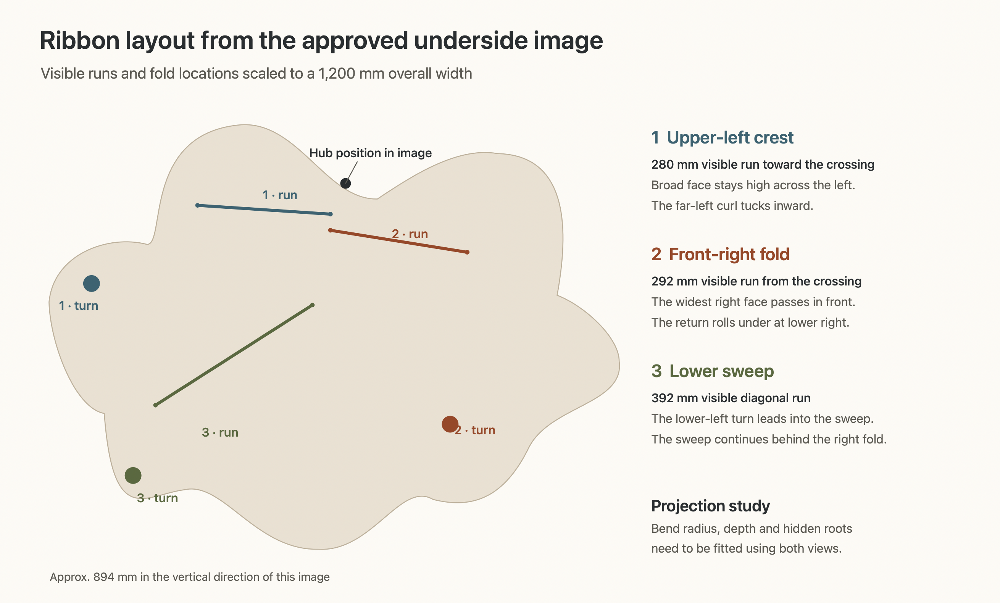

# Reference-led ribbon plan — calculation V01

**Stage:** geometry and support plan only. No Blender geometry was changed. This is a dimensioned proposal for the next blockout, not an exact recovery of the concept image or a print/safety release.

## What is measured and what is chosen

The approved underside view gives a useful 2D guide, but it is a perspective image rather than a dimensioned CAD drawing. The side view supplies the over/under order, but it does not fix the 3D path, centre of gravity, or structural load path. The marked coordinates below preserve the visible crossing directions and folds. Bend radii, depth, ribbon widths, route lengths, wall sections, and support stations are design choices that must be checked in a 3D blockout.

Scale the image's marked outline width from 1,167 px to 1,200 mm:

~~~text
s = 1,200 / 1,167 = 1.02828 mm/px
projected outline = 1,200 × 893.6 mm
~~~

The target user described is a near-round ceiling area. The image outline is noticeably short in its second direction, with a 0.745 aspect ratio. Keep the reference's local runs and folds, and extend the outer lobes by about 78 mm at each end of that short direction to make a **1,200 × 1,050 mm** working footprint (0.875 aspect ratio). This is a local outline change, not a global Y stretch. The new footprint is still mildly oval; the actual underside blockout must be judged against the room and the user's round-space requirement.

Coordinates use the outline centre as origin, X right, Y up. Hub and fold marks are image projections, not physical attachment coordinates.

| Feature | Image points / marker | Projected measurement or position |
|---|---|---:|
| A, upper-left crest | (345,361) → (617,379) | 280.3 mm, −3.8° |
| B, front-right face | (617,412) → (897,457) | 291.6 mm, −9.1° |
| C, lower diagonal | (259,770) → (580,565) | 391.6 mm, +32.6° |
| Hub marker | (648,316) | (+24,+324) mm |
| A fold neighbourhood | (128,521) | (−511,+113) mm |
| B fold neighbourhood | (862,809) | (+244,−184) mm |
| C fold neighbourhood | (213,914) | (−423,−292) mm |

The A and B runs are nearly parallel; their direction differs by about 5.3°. C crosses diagonally by about 33°. These are the harmonic cues to preserve. The 280 / 292 / 392 mm values are projected chord lengths between hand-picked image points. They are straight-run targets, not surveyed centreline lengths. Fold neighbourhoods locate where to turn; they are not bend centres.

## Three continuous routes

Use three broad continuous root-to-root ribbons with loop-like routes crossing through the middle. Each ribbon has two physical ends; keep both roots hidden in the small central mounting area. The visible routes should read as follows:

| Ribbon | Visible route to preserve | Total centreline budget | Remainder after visible run + one main turn |
|---|---|---:|---:|
| A | Upper-left crest runs straight toward the crossing, then returns through the far-left tucked fold. | 1,900 mm | 1,271 mm |
| B | The broad front-right face runs nearly straight, rolls under at lower right, then returns behind the visible folds. | 1,800 mm | 1,113 mm |
| C | The lower-left turn feeds the long diagonal sweep, which passes behind B at the right tuck. | 2,000 mm | 1,259 mm |

The route budgets are visual estimates for mass and panel planning. The remainder is the combined length for hidden leads, tucked returns, and any other transition. It is **not** one straight segment with fixed endpoints. Do not force the visible faces to radiate from the hub. The hidden portions can approach the six central root seats underneath the crossings.

### Bend math

Use long zero-curvature tangent zones, one deliberate turn at each marked fold, then return to zero curvature. Use two 35 mm linear-curvature shoulders around one constant-radius core. For total turn angle θ, core radius R, and shoulder length ℓ:

~~~text
combined shoulder heading = ℓ / R
core angle θc = θ − ℓ/R
core arc length = R θc
full turn length = 2ℓ + Rθc = Rθ + ℓ
inner-edge radius = R − ribbon_width/2
~~~

| Turn | Width at turn | Centreline R | Total turn | Each shoulder | Core angle | Core arc | Full turn | Inner edge R |
|---|---:|---:|---:|---:|---:|---:|---:|
| A, far left | 170 mm | 120 mm | 150° | 35 mm | 133.29° | 279.2 mm | 349.2 mm | 35 mm |
| B, lower right | 180 mm | 125 mm | 165° | 35 mm | 148.96° | 325.0 mm | 395.0 mm | 35 mm |
| C, lower-left turn | 170 mm | 120 mm | 150° | 35 mm | 133.29° | 279.2 mm | 349.2 mm | 35 mm |

All three turns retain the same 35 mm inside-edge radius. B can widen smoothly to 190 mm on its broad front face, away from the tight core; blend that width change over 80–120 mm. The radii are tight but keep a positive inside edge and a readable curled return. The blockout must check offset surfaces, self-clearance, and the under/over order. If a turn pinches, increase its radius and re-fit the path; do not add control-point oscillations.

The unmodified paths contain no periodic wave or surface ripples. Use constant offsets from the centreline for the clean surface lines. Bank and height are separate controls. Blend each intentional height or bank change once across an 80–120 mm transition with the quintic smoothstep f(u)=6u^5−15u^4+10u^3; keep straight sections straight between those transitions.

### Side profile and clearance

Carry the high left sweep near the ceiling, put the B face in front at its broad right crossing, roll B down and under at the lower-right tuck, and pass C behind that return. Use **160–180 mm** as the ceiling-to-lowest-point working range, with **180 mm** as the first blockout ceiling. At non-jointed crossings, keep 12–18 mm clear space between skins. At the three hidden tucked/crossing regions, use small sets of load-bearing keyed lands that are part of the ribbon backs. Each loop-like route still needs about three intermediate support stations; check how many can fit inside those existing overlap regions without extending beyond the silhouette. The side image does not provide a calibrated depth; 180 mm is a shallow-profile design target, not a measurement.

## Concealed support and the load path

The form remains the structure: there are no visible outer straps, radial support arms, or perimeter ceiling rail. Capture both ends of A, B, and C inside one compact central fitting, giving six hidden roots. Start with a 100–120 mm centre cap and a hidden metal spreader plate; confirm that the six return ends fit without opening into visible spokes. Use the natural crossing/tuck regions as positive load-transfer points. A soft visual overlap alone does not carry a dependable load; each hidden joint needs a rear-facing key/lap and mechanical retention. Place the key on the back of the existing ribbon face so the visible curve stays continuous.

At each ribbon's back edge, start with a 1.6 mm face and two 12 × 1.6 mm rear returns that face toward the ceiling/inside. This is an integral shallow U-section, not a separate strap. Avoid putting those returns on the room-facing silhouette. Aim for **400–450 mm spacing** between positive support points and keep any bay below 500 mm. A 1.9 / 1.8 / 2.0 m root-to-root route with two hub roots needs about three intermediate load-transfer stations to keep its bays near 475 / 450 / 500 mm. Those stations must be inside existing visual overlaps; the two or three large folds alone do not guarantee enough contacts. If the reconstructed path cannot provide the support spacing within its silhouette, deepen the same ribbon's hidden return or make its overlap land longer before adding any new support geometry.

### Screening calculations for the integral return

For a constant section with face width W, wall t=1.6 mm, and each return depth h=12 mm, the cross-section area is (W + 2h)t. Using the face from z=0..t and the returns from z=t..t+h, the centroid calculation gives:

| Mean face width | Section area | Section I about the width axis | PETG mass per metre |
|---:|---:|---:|---:|
| 170 mm | 310.4 mm² | 2,074.8 mm⁴ | 0.394 kg/m |
| 150 mm | 278.4 mm² | 2,042.7 mm⁴ | 0.354 kg/m |

For a simply supported straight span, uniformly loaded, use δ = 5qL⁴ / (384EI). For a deliberately conservative screen, spread a 4.0 kg full assembly evenly over 5.7 m of route: q = 4 × 9.81 / 5.7 = 6.88 N/m. Use an assumed effective printed-PETG modulus of 1.5 GPa only for this comparison.

| Span between positive seats | Estimated static sag at the 4 kg mass budget | Sag at a 5× screening load |
|---:|---:|---:|
| 400 mm | 0.74–0.75 mm | 3.69–3.74 mm |
| 450 mm | 1.18–1.20 mm | 5.91–6.00 mm |
| 500 mm | 1.80–1.83 mm | 9.00–9.14 mm |
| 600 mm | 3.73–3.79 mm | 18.66–18.96 mm |

At 500 mm with a root-only cantilever instead of two positive seats, this same beam comparison gives about 17 mm of static deflection, or about 86 mm at 5×. The central roots alone therefore do not support a long loop; the tucked contacts must be real load-bearing nodes. These beam figures assume the return depth points into gravity, no cross-section twist, no creep, and ideal joints. A banked fold, open-section torsion, layer direction, LED heating, local buckling, and years under load are not represented. Use them to choose support spacing, then test a full-size ribbon and joint.

### Centre, attachment, and force budget

The projected hub mark is not proof of the 3D centre of mass. Calculate the combined CAD mass centre after placing the three routes, LEDs, wiring, cover, and metal fitting. Aim to place it within 10 mm of the visible central hook axis, then confirm with a physical balance test. At the 4 kg mass budget, the static imbalance moment is 0.39 N·m at 10 mm eccentricity and 1.57 N·m at 40 mm. A freely pivoting single hook cannot hold that offset level; the lamp will rotate until its centre of mass hangs below the hook. If the ceiling-close fitting must resist rotation, keep its anti-rotation feature inside the same compact central mount and test the moment as well as the vertical load.

| Load case | Calculation |
|---|---:|
| Working mass budget | 4.0 kg |
| Static weight | 4.0 × 9.81 = 39.2 N |
| 5× whole-lamp bench screen | 39.2 × 5 = 196 N |
| Equal share across six roots at screen load | 196 / 6 = 32.7 N/root |
| Individual root-seat capacity target | 300 N per seat in the relevant pull/shear direction |

The 300 N per-seat value lets one root carry the 196 N whole-lamp screening load with roughly 1.5× reserve; it is a prototype target, not a certified working-load rating. The central metal path must carry at least the 196 N whole-lamp screen and the calculated off-axis moment. Use captured through-fasteners into metal for the central load path. The actual ceiling fixing must be selected for the real ceiling substrate and its manufacturer's rating. Neither a polymer screw thread nor a visual interlock alone is adequate evidence of overhead retention.

## Mass and print planning

The mean-width area estimate is path length × mean width:

| Ribbon | Path budget | Mean width | Surface area | 1.6 mm PETG skin mass |
|---|---:|---:|---:|---:|
| A | 1.9 m | 170 mm | 0.323 m² | 0.656 kg |
| B | 1.8 m | 150 mm | 0.270 m² | 0.549 kg |
| C | 2.0 m | 170 mm | 0.340 m² | 0.691 kg |
| **Total** | **5.7 m** | — | **0.933 m²** | **1.896 kg** |

The [Prusament PETG technical data sheet](https://prusament.com/wp-content/uploads/2022/10/PETG_Prusament_TDS_2021_10_EN.pdf) lists nominal density 1.27 g/cm³. That yields 1,492.8 cm³ / 1.896 kg for the 1.6 mm skin. Two continuous 12 × 1.6 mm returns over 5.7 m add 218.9 cm³ / 0.278 kg. Total face plus returns is about **2.174 kg** before seams, roots, hub, lights, and slicer variation. A 1.2 mm sample would reduce face mass to about 1.422 kg, but 1.6 mm (four 0.4 mm lines) is the safer first structural baseline until a full-size light and stiffness sample is tested.

| Added assembly item | Planning allowance |
|---|---:|
| Integral 20 mm panel laps, root seats, tuck keys, local thickening | 0.20–0.31 kg |
| Three short LED segments, cable pairs, small aluminum spreaders, splitter | 0.08–0.19 kg |
| Compact central metal hub, eye, bolts, small cover | 0.25–0.50 kg |
| **Estimated assembly, driver remote** | **2.70–3.17 kg** |
| Add an onboard driver if needed | **+0.10–0.25 kg** |
| **Estimated assembly, driver in centre** | **2.80–3.42 kg** |

Use 4.0 kg as the full-up mass budget for early support calculations. The estimate includes no hidden full-length metal spines. It is based on the approximate route lengths and widths above, not the V12 mass, and not on final slicer toolpaths. The 8 × 15 × 1.5 mm aluminum spine discussed as a fallback would add about 0.162 kg per metre; a full 5.7 m set would add about 0.92 kg. Do not add that reinforcement by default. First test the integral ribbon returns and keyed overlaps; only add a concealed spine if the measured sample requires it.

The [Anycubic Kobra S1 Max manual](https://wiki.anycubic.com/M02010206-Kobra%20S1%20Max%E7%94%A8%E6%88%B7手册-EN-260106.pdf) lists a 350 × 350 × 350 mm print volume. Plan to 320 mm per axis to leave room for brim/support and curved-part bounding boxes. With 240–260 mm net travel per panel and about 20 mm integral lap length, the route budgets give **23–25 pieces**: A about 8, B 7–8, C 8–9. Since each ribbon has two hub ends rather than closing as a ring, that means about **20–22 panel-to-panel laps** across the three paths. Keep each broad face about 140–180 mm wide; place its long direction along a bed axis. Stagger seams between ribbons by 70–100 mm and keep them out of the bright straight runs, fold cores, and LED pockets. The curved panel's actual 3D box and orientation may require more pieces; confirm in Blender and the slicer before freezing the seam count.

## LED and wire positions

Reserve one short, concealed pocket in each major bend: the far-left tuck in A, the inner lower-right fold in B, and the lower turn in C. Start with about 100 mm per station, aimed across the hollow or up toward the adjacent translucent ribbon. Hide the tape, connector, and heat spreader behind the return so none are visible from the room side. Use small aluminum heat spreaders inside those bends.

Route one two-conductor pair in a provisional 6 × 4 mm chase behind the inner return of each ribbon, ending in one parallel connection under the central service cover. No wires cross an exposed face or a keyed joint. A provisional 24 V strip at 9.6 W/m with three 100 mm segments uses 0.30 m of tape, 2.88 W and 0.12 A. This is an electrical sizing example only; select the actual COB strip, cut pitch, channel, driver, and thermal limits before final pocket dimensions. The center cover stays small and only encloses the hanger, connections, and service access; there is no broad roof/deck.

## Decisions carried forward and checks still needed

- Keep the three crossing runs, nearly parallel A/B direction, diagonal C run, broad right-front fold, lower-right tuck, and behind-the-fold C sweep. Do not use a radial spoke layout.
- Keep long straight tangent runs and one intentional eased turn per fold. Do not add sine waves, repeated spline points, surface ripples, or extra decorative curls.
- Keep the outer shell smooth and uninterrupted. Put the structural returns, keyed joins, wire chases, and LED pockets on the hidden back/inside faces.
- Start the next blockout from these parameters and compare underside plus low side before adding joints. The key geometry is still assumed because two images cannot uniquely determine the full 3D path.
- Replace route length, surface area, mass, centre-of-gravity, contact-span, and part-count estimates with evaluated Blender geometry, a selected filament/material, exact LED hardware, and slicer reports.
- Verify actual print orientation, joint fit, all-view LED concealment, temperature, sag/creep, root retention, hub capacity, and the real ceiling fixing with physical samples before overhead installation.

The calculations are reproducible in [calculate_candidate.py](calculate_candidate.py); the machine-readable output is [candidate-calculations.json](candidate-calculations.json).
