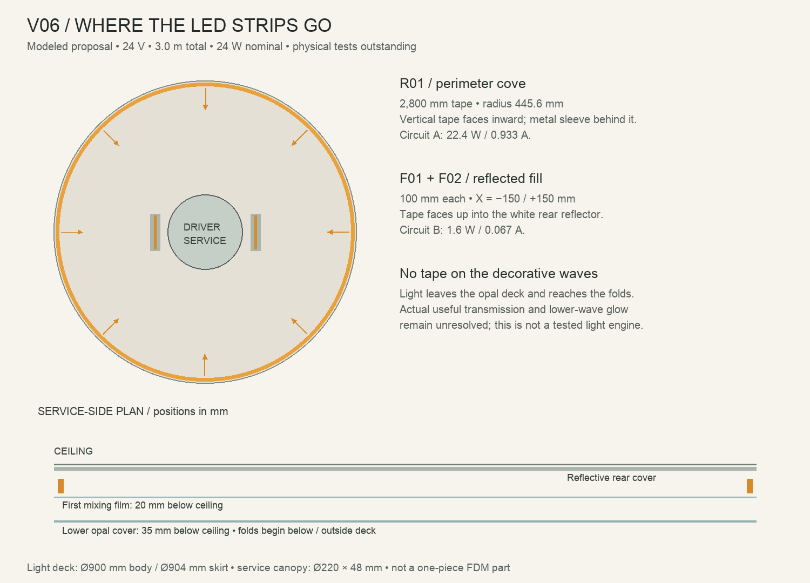

# REJECTED / SUPERSEDED BY V07

The user explicitly rejected the broad ceiling base. The following V06 deck design is historical only. Do not use it as the current support or lighting plan. Only a central ceiling attachment is allowed. See [lighting-v07/README.md](../lighting-v07/README.md).

# V06 — shallow ceiling light deck

4 November 2026. The V06b surface-ripple project retains this lighting architecture (same strip lengths, circuits and deck dimensions). Placement geometry is present in its own scene. Current modeled optical and mounting study, **not an accepted appearance or tested lighting kit**. Open `../Circular-Ribbon-Cloud-v06-light-deck.blend`.

## Where the strips go

All tape lives in the ceiling deck, above the visible waves. No tape follows the decorative ribbon edges. A perimeter cove aims inward; two short fill sections aim upward into the white rear reflector. The mixing film and opal cover spread this light downward. This layout replaced exposed trays within individual folds and an eight-straight-strip deck that showed strip patterns through its cover.

| ID | Location and aim | Length | Circuit | Nominal electrical power |
| --- | --- | ---: | --- | ---: |
| R01 | Vertical ring, radius 445.6 mm, centre height 18 mm below ceiling; faces inward | 2,800 mm | A | 22.4 W |
| F01 | X=-150 mm, Y=0; 100 mm along Y, faces upward | 100 mm | B | 0.8 W |
| F02 | X=+150 mm, Y=0; 100 mm along Y, faces upward | 100 mm | B | 0.8 W |

Ceiling centre is origin; negative Z is downward. Total **3.0 m, 24 W, 1.0 A at 24 V**. Circuit A is 0.933 A; B is 0.067 A. Raw nominal strip flux is 2,100 lm **before** reflector, diffuser and shade losses; delivered output has not been measured.

## Physical assembly

- Nominal 900 mm deck body, 904 mm retaining skirt, 35 mm body depth; separate 220 mm diameter × 48 mm central service canopy.
- Reflective rear cover: 0.8 mm. First opal mixing film: nominal 0.4 mm, 20 mm below ceiling. Lower opal cover: nominal 1 mm, 35 mm below ceiling. These are purchased/cut sheet candidates; their transmission and optical spacing are untested.
- R01 mounts on a continuous metal heat sleeve, connected to the rim by a metal lip. Its 8 mm tape width runs vertically, bending around a large cylinder in the normal flexible direction. Confirm the actual manufacturer's installation requirements.
- F01/F02 mount on separate 20 × 110 × 2 mm aluminum rails, pointing upward. They do not illuminate the lower cover directly.
- Upper/lower 1.5 mm continuous shadow reveals and internal opaque baffles provide a passive ventilation concept. They are not evidence of acceptable operating temperatures.
- Two-core low-voltage routes are modeled along the internal carrier. Final connector housings, wire gauges, strain relief, protected terminals and controller mounting need actual component selection.
- The printed shade is removable separately from the metal light deck. Integral printed folded returns seat on paired-screw receivers inside the deck; the lower cover has actual return slots with modeled opaque seals. Some returns remain visible from review views: concealment is **not accepted**.

## Components and procurement status

Reference tape: **Koala Components AD808108**, 24 V, 2700 K, CRI ≥90, 8 W/m, 700 lm/m, 8 × 1.6 mm, 100 mm cut pitch. All current lengths respect that pitch. [Manufacturer sheet](https://www.koalacomponents.com/catalogue/articulos/mostrar_pdf/flexible-led-strip-5m-cob-320led-m-ip20-24v-8w-m-40w-2700k).

Driver fit candidate: **MEAN WELL LPF-40-24**, non-D constant-voltage model, modeled 162.5 × 43 × 32 mm envelope. Current 24 W tape load is about 60% of the nominal 40 W class. Installed temperature derating, enclosure fit and system compatibility remain to be checked. [Manufacturer specification](https://www.meanwell.com/Upload/PDF/LPF-40/LPF-40-SPEC.PDF). Follow the manufacturer's installation and switched-mains requirements.

A separate two-channel 24 V secondary PWM dimmer has only a 55 × 30 × 14 mm space reservation. No controller SKU is selected. Do not order an unspecified dimmer on the assumption it fits or works with this driver.

Other prototype parts: cut reflective sheet, opal sheet/film, metal perimeter sleeve/rim, carrier flat stock, provisional 3 mm receiver plates, screws/nuts, and opaque compliant slot seals. Final grades, fastening, retention and purchased parts must follow full-size optical/fit/thermal tests. The 900 mm metal/opal deck is not a one-piece FDM print.

## Evidence and current rejection points

Blender includes 48 area proxies along the ring and two at the fill rails. Combined proxy power is an **uncalibrated 28% radiant equivalent** of nominal electrical power. This is not measured photometry. Paper/opal shaders are appearance approximations. The render includes separately named room light.

`../checks/v06-source-visibility.json` reports no direct exposed emitting-face probes in 42 sampled review positions. It checks opaque occlusion only; it does not test glare, luminance, diffuse silhouettes or every possible viewpoint. The current warm render still concentrates glow near the ceiling; the central waves are too crowded and insufficiently illuminated compared with the reference. The concept therefore **does not pass the appearance gate**.

Next optical test: a representative portion of the ring/mixing cavity with actual opal materials and actual shade coupons at real spacing. Measure useful transmission, bright lines, hardware silhouettes and operating temperatures. Tune ring/fill ratio with the actual dimmer before freezing positions. Do not add arbitrary decorative emission to the Blender skins to conceal a failed optical design.
