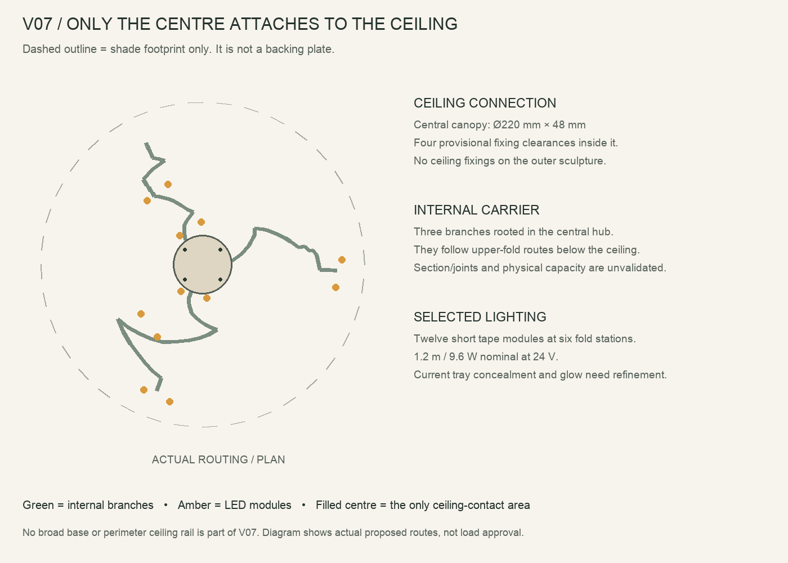

# V07 — centre-mounted carrier and selected fold lighting

**Supersedes the rejected V06 ceiling light deck.** The only ceiling attachment is the compact central Ø220 mm canopy/plate. There is no 900 mm backing plate, perimeter ceiling rail or outer ceiling anchor. The central plate has four provisional fixing clearances, all inside its footprint. Their anchor type and capacity are not selected.

## Load route and fabrication status

Ceiling fixings → central metal hub → three branches in separate approximately 120° sectors → paired back-side saddles → ribbon skins. The branches extend within the sculpture, below the ceiling. They are not attached to the ceiling along their lengths. All physical carrier, light housings and wiring remain enabled in normal review renders.

The branches use an illustrative 18 × 16 × 1.5 mm hollow-section envelope that follows the upper folds. These are **routing/section studies**, not a selected bent extrusion or a ready fabrication drawing. Practical segments, bends/splices, brackets, joint access and deflection must be resolved before building. The paired saddle reinforcements overlap the skins in the assembly but are not yet Boolean-unioned into production parts; do not describe them as finished integral printed joints. Retention/clearance details are provisional.

The six bare ripple skins calculate to about 1.79 kg at nominal PETG density 1.27 g/cm³. That excludes saddles, all carrier metal, LEDs, driver, fasteners and wiring. It is a modeled volume estimate, not a weighed assembly or proof of structural capacity.

## LEDs and their placement

Six selected stations, two on each large ribbon. Each station has two straight 100 mm tape modules with short wire bridges. They face the back of nearby ribbon surfaces, approximately 35–37 mm away at the centre of each station. Each modeled cell has a metal heat bed, opaque side/end lips and an opal exit. No tape follows every ripple or visible edge. The 1.2 m total is 9.6 W / 0.40 A at nominal 24 V full output. Spatially offset modules need actual samples to establish usable spacing and diffusion.

| Module | Ribbon | X / Y / Z (mm from ceiling centre) | Tape | Nominal power |
| --- | --- | --- | ---: | ---: |
| L01 | W01 | 493.4 / -84.6 / -107.7 | 100 mm | 0.8 W |
| L02 | W01 | 516.4 / 17.9 / -74.9 | 100 mm | 0.8 W |
| L03 | W01 | -218.0 / -464.4 / -107.2 | 100 mm | 0.8 W |
| L04 | W01 | -121.1 / -506.3 / -137.8 | 100 mm | 0.8 W |
| L05 | W02 | -129.1 / 296.2 / -165.9 | 100 mm | 0.8 W |
| L06 | W02 | -204.8 / 236.8 / -112.5 | 100 mm | 0.8 W |
| L07 | W02 | -229.0 / -183.0 / -117.9 | 100 mm | 0.8 W |
| L08 | W02 | -167.9 / -268.0 / -151.7 | 100 mm | 0.8 W |
| L09 | W03 | -80.7 / -98.6 / -155.2 | 100 mm | 0.8 W |
| L10 | W03 | 15.3 / -124.9 / -202.2 | 100 mm | 0.8 W |
| L11 | W03 | -6.0 / 156.8 / -203.7 | 100 mm | 0.8 W |
| L12 | W03 | -83.8 / 107.5 / -143.6 | 100 mm | 0.8 W |

Reference strip remains Koala Components AD808108: 24 V, 2700 K, 8 W/m, 100 mm cut pitch. The 100 mm modules respect its marked cut interval. [Manufacturer sheet](https://www.koalacomponents.com/catalogue/articulos/mostrar_pdf/flexible-led-strip-5m-cob-320led-m-ip20-24v-8w-m-40w-2700k). This remains a prototype baseline, not a frozen product BOM.

The former LPF-40-24 and controller envelopes are retained inside the central canopy as **space reservations only**. The 9.6 W arrangement requires driver/controller selection to be reopened; do not interpret the retained 40 W envelope as a compatibility or procurement recommendation. Final connectors, gauges, terminals and strain relief are not modeled to a selected hardware set.

Low-voltage looms follow the three branches from the central service area. The driver stays accessible at the centre. Cover removal, individual station replacement and all mechanical access must be demonstrated on the partial assembly.

## Review and remaining work

[Warm review](../renders/v07-centre-warm.png), [unlit review](../renders/v07-centre-unlit.png), [directly below](../renders/v07-centre-below.png), and [carrier-only technical cutaway](../renders/v07-centre-carrier-cutaway.png). The cutaway omits the skins and ceiling for explanation; it is not concealment evidence.

The large-base correction is implemented. Some light housings and internal connections remain visible, and light balance is not yet close to the reference. Their concealment is **not accepted**. All supports remain present in normal images. No bare-source glare, all-angle concealment, temperature, load rating or production-print acceptance is claimed.

Blender uses area-light proxies at the actual modeled tape locations, at an uncalibrated 28% radiant equivalent of electrical power. Paper/opal materials are appearance approximations. No fake emission is assigned to the shade skins. Keep these limits explicit when interpreting the preview.
